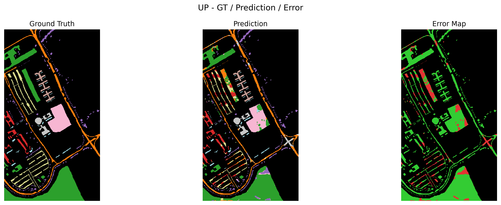
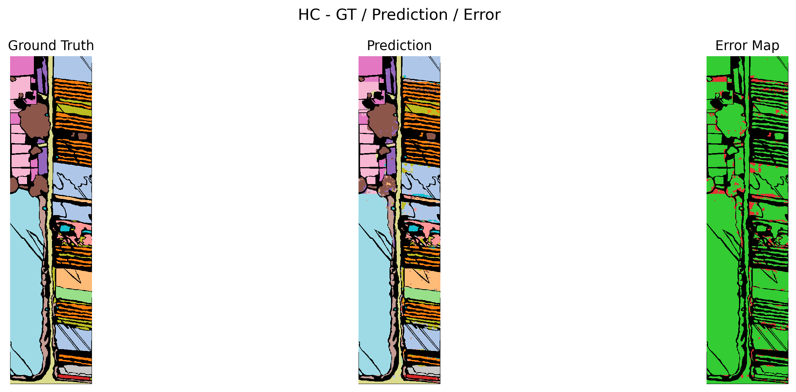
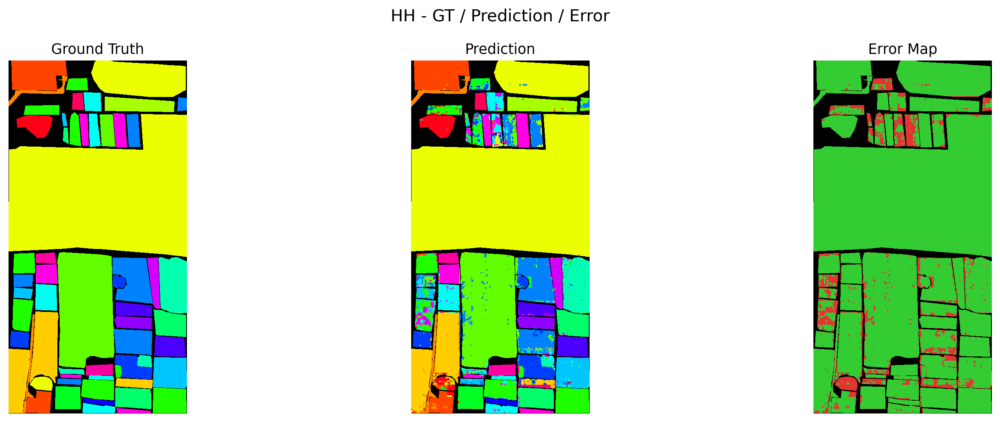
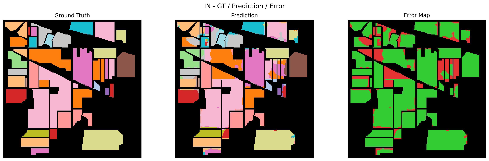
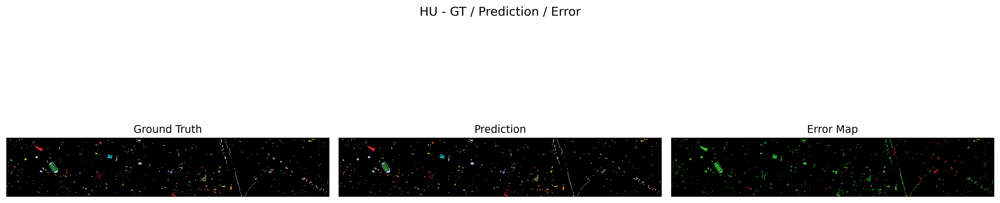

# LH-MAE: A Lightweight Hyperspectral Masked Autoencoder Learning Band Correlation

This repository provides the downstream classification evaluation code for **LH-MAE (Lightweight Hyperspectral Masked Autoencoder)** with **MR-MAE as the reference/teacher encoder**. The pretrained LH-MAE student is transferred to five hyperspectral image classification benchmarks: Pavia University (UP), HanChuan (HC), HongHu (HH), Indian Pines (IN), and Houston (HU).

The commands below **fine-tune and evaluate** a pretrained student on each benchmark; they are not inference-only commands.

## Reported classification performance

The following table compares the **MR-MAE reference/teacher** with the **LH-MAE student** on five downstream classification benchmarks. Overall Accuracy (OA) is reported in percent, and parameters are reported in millions (M).

| Model | Metric | Indian Pines | Pavia University | Houston | HongHu | HanChuan |
| :-- | :-- | --: | --: | --: | --: | --: |
| MR-MAE (teacher) | OA (%) | 74.91 | 91.12 | 82.61 | 95.29 | 94.73 |
| LH-MAE (student) | OA (%) | 83.87 | 91.90 | 79.50 | 93.43 | 93.86 |
| MR-MAE (teacher) | Parameters (M) | 210.194 | 210.193 | 210.194 | 210.196 | 210.194 |
| LH-MAE (student) | Parameters (M) | 6.107 | 6.107 | 6.107 | 6.107 | 6.107 |

The released downstream commands use only the pretrained LH-MAE student; the MR-MAE teacher is shown for reference and is not loaded during fine-tuning or evaluation.

## Environment and installation

- Python: **3.10.19**
- PyTorch: **2.1.2+cu118**
- TorchVision: **0.16.2+cu118**
- `timm`: **1.0.19**
- CUDA wheel build: **11.8**

Install the pinned dependencies:

```bash
python -m pip install -r requirements.txt
```

The requirements file uses the official CUDA 11.8 PyTorch package index. A compatible NVIDIA driver and GPU are required for the CUDA commands below. The optional `--measure_macs` feature additionally requires `thop`, which is not part of the supplied working-environment package list.

## Repository layout

```text
.
├── downstream_mrmae_lhmae_all6_official_split.py
├── model/
│   ├── split_data.py
│   ├── utils.py
│   ├── create_graph.py
│   └── data_reader.py
├── mae_lite/
│   ├── models/
│   └── utils/
├── util/
│   ├── __init__.py
│   └── pos_embed.py
├── outputs/
│   └── student_stage2.pth
├── visualized_results/
├── requirements.txt
└── README.md
```

Place the pretrained student checkpoint at:

```text
outputs/student_stage2.pth
```

The benchmark datasets are **not included** in this repository. Obtain them from their respective providers and organize the files as shown below.

| Benchmark | Dataset provider |
| :-- | :-- |
| Indian Pines (IN) | [EHU Hyperspectral Remote Sensing Scenes](https://www.ehu.eus/ccwintco/index.php/Hyperspectral_Remote_Sensing_Scenes) |
| Pavia University (UP) | [EHU Hyperspectral Remote Sensing Scenes](https://www.ehu.eus/ccwintco/index.php/Hyperspectral_Remote_Sensing_Scenes) |
| HanChuan (HC) | [Wuhan University WHU-Hi](https://rsidea.whu.edu.cn/e-resource_WHUHi_sharing.htm) |
| HongHu (HH) | [Wuhan University WHU-Hi](https://rsidea.whu.edu.cn/e-resource_WHUHi_sharing.htm) |
| Houston (HU) | [2013 IEEE GRSS Data Fusion Contest](https://www.grss-ieee.org/community/technical-committees/2013-ieee-grss-data-fusion-contest/) |

**Note:** The dataset filenames and internal MATLAB variable names supplied by these sources may differ from those expected below. In particular, the Houston loader expects a combined `Houston_official.mat` file containing the official `TR` and `TE` maps. Prepare the downloaded data in the format required by the loader, while preserving the official split and the source providers' usage terms.

```text
datasets/
├── UP/
│   ├── PaviaU.mat
│   └── PaviaU_gt.mat
├── HC/
│   ├── WHU_Hi_HanChuan.mat
│   └── WHU_Hi_HanChuan_gt.mat
├── HH/
│   ├── WHU_Hi_HongHu.mat
│   └── WHU_Hi_HongHu_gt.mat
├── IN/
│   ├── Indian_pines_corrected.mat
│   └── Indian_pines_gt.mat
└── HU/
    └── Houston_official.mat
```

**Dataset splits:** IN uses 10 labeled pixels per class; UP uses 20; HC and HH use 50 each. HU uses the official `TR`/`TE` maps in `Houston_official.mat`. The training subset for IN, UP, HC, and HH depends on the random seed.

## Downstream benchmark commands

Run these commands from the repository root. The experiments use PCA 10 components, the spectral adapter (HSBA), decoder removal, spectral depth 1, batch size 16, and GPU 0. To select a different GPU, change `CUDA_VISIBLE_DEVICES=0` to the desired GPU index. Each experiment saves its outputs in a separate directory.

### 1. Pavia University (UP)

```bash
OUTDIR="outputs/UP_MRMAE_LHMAE_paper_split/seed_0"
mkdir -p "$OUTDIR"

CUDA_VISIBLE_DEVICES=0 python downstream_mrmae_lhmae_all6_official_split.py \
  --dataset UP --data_root datasets \
  --ckpt outputs/student_stage2.pth \
  --use_spectral --remove_decoder --spectral_depth 1 \
  --img_size 32 --patch_size 4 --pca_components 10 --train_num 20 \
  --seed 0 --batch_size 16 --max_epoch 150 \
  --lr 1e-4 --weight_decay 0.005 --accum_steps 1 \
  --eval_start 30 --eval_every 30 --save_vis \
  --output_dir "$OUTDIR" 2>&1 | tee "$OUTDIR/console.log"
```

### 2. HanChuan (HC)

```bash
OUTDIR="outputs/HC_MRMAE_LHMAE_paper_split/seed_0"
mkdir -p "$OUTDIR"

CUDA_VISIBLE_DEVICES=0 python downstream_mrmae_lhmae_all6_official_split.py \
  --dataset HC --data_root datasets \
  --ckpt outputs/student_stage2.pth \
  --use_spectral --remove_decoder --spectral_depth 1 \
  --img_size 32 --patch_size 4 --pca_components 10 --train_num 50 \
  --seed 0 --batch_size 16 --max_epoch 150 \
  --lr 1e-4 --weight_decay 0.005 --accum_steps 1 \
  --eval_start 30 --eval_every 30 --save_vis \
  --output_dir "$OUTDIR" 2>&1 | tee "$OUTDIR/console.log"
```

### 3. HongHu (HH)

```bash
OUTDIR="outputs/HH_MRMAE_LHMAE_paper_split/seed_0"
mkdir -p "$OUTDIR"

CUDA_VISIBLE_DEVICES=0 python downstream_mrmae_lhmae_all6_official_split.py \
  --dataset HH --data_root datasets \
  --ckpt outputs/student_stage2.pth \
  --use_spectral --remove_decoder --spectral_depth 1 \
  --img_size 32 --patch_size 4 --pca_components 10 --train_num 50 \
  --seed 0 --batch_size 16 --max_epoch 150 \
  --lr 1e-4 --weight_decay 0.005 --accum_steps 1 \
  --eval_start 30 --eval_every 30 --save_vis \
  --output_dir "$OUTDIR" 2>&1 | tee "$OUTDIR/console.log"
```

### 4. Indian Pines (IN)

```bash
OUTDIR="outputs/IN_MRMAE_LHMAE_paper_split/seed_0"
mkdir -p "$OUTDIR"

CUDA_VISIBLE_DEVICES=0 python downstream_mrmae_lhmae_all6_official_split.py \
  --dataset IN --data_root datasets \
  --ckpt outputs/student_stage2.pth \
  --use_spectral --remove_decoder --spectral_depth 1 \
  --img_size 32 --patch_size 4 --pca_components 10 --train_num 10 \
  --seed 0 --batch_size 16 --max_epoch 150 \
  --lr 1e-4 --weight_decay 0.005 --accum_steps 1 \
  --eval_start 30 --eval_every 30 --save_vis \
  --output_dir "$OUTDIR" 2>&1 | tee "$OUTDIR/console.log"
```

### 5. Houston (HU)

Houston follows the official training/test split and uses **60 epochs**, with evaluations scheduled at epochs 30 and 60.

```bash
OUTDIR="outputs/HU_MRMAE_LHMAE_paper_split/seed_0"
mkdir -p "$OUTDIR"

CUDA_VISIBLE_DEVICES=0 python downstream_mrmae_lhmae_all6_official_split.py \
  --dataset HU --data_root datasets \
  --ckpt outputs/student_stage2.pth \
  --use_spectral --remove_decoder --spectral_depth 1 \
  --img_size 32 --patch_size 4 --pca_components 10 \
  --seed 0 --batch_size 16 --max_epoch 60 \
  --lr 1e-4 --weight_decay 0.005 --accum_steps 1 \
  --eval_start 30 --eval_every 30 --save_vis \
  --output_dir "$OUTDIR" 2>&1 | tee "$OUTDIR/console.log"
```

## Visualized results

The following classification visualizations are stored in [`visualized_results/`](./visualized_results/) and displayed here in the same order as the benchmark commands.

### Pavia University (UP)



### HanChuan (HC)



### HongHu (HH)



### Indian Pines (IN)



### Houston (HU)



## Notes on reproducibility

- `--save_vis` writes result visualizations to the experiment's output directory, while `visualized_results/` contains the curated examples for the repository.
- The official HU test split must be preserved. Do not replace it with a random per-class split.
- Keep the checkpoint path and the runtime package versions consistent with the working environment for best reproducibility.

